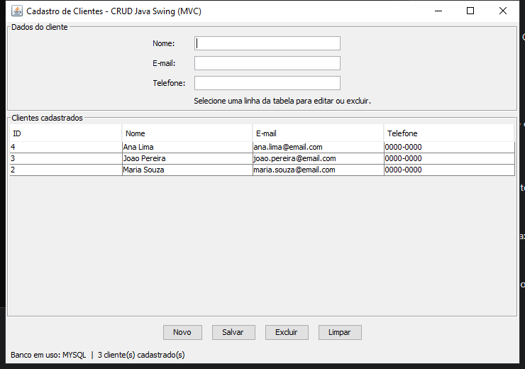

# CRUD MVC — Java Swing

Aplicação desktop para cadastro de clientes, desenvolvida em Java Swing com arquitetura MVC e persistência via JDBC. Permite cadastrar, listar, editar e excluir registros.



## Tecnologias

- Java (JDK)
- Swing para a interface gráfica
- JDBC para acesso ao banco
- MySQL (configuração principal) ou SQLite (alternativa)

## Requisitos

- Windows com JDK instalado (`java -version` no Prompt de Comando)
- Para MySQL: MySQL Server iniciado. O MySQL Workbench é opcional e pode ser usado para visualizar os dados.

## Como executar no Windows

1. Clone ou baixe este repositório.
2. Copie `database.properties.example` para `database.properties`.
3. Abra `database.properties` e preencha `mysql.password` com a senha local do seu MySQL. Não compartilhe nem versione esse arquivo.
4. Dê duplo clique em `executar.bat`.

O script compila o projeto e abre a interface. Na primeira execução, a aplicação cria o banco `bd_trabnp2` e a tabela `tb_clientes` automaticamente; não é necessário criá-los no Workbench. Para conferir os registros no Workbench, execute:

```sql
SELECT * FROM bd_trabnp2.tb_clientes;
```

Para testar a conexão e as operações CRUD sem abrir a interface, execute `testar_conexao.bat`.

### Usar SQLite

Para usar SQLite em vez do servidor MySQL, defina `db.type=sqlite` em `database.properties`. O arquivo local `banco.db` será criado automaticamente.

## Funcionalidades

- **Cadastrar:** informe nome, e-mail e telefone e selecione **Salvar**.
- **Visualizar:** os registros aparecem na tabela.
- **Editar:** selecione uma linha, altere os campos e selecione **Salvar**.
- **Excluir:** selecione uma linha e escolha **Excluir**; a aplicação pede confirmação.

## Organização MVC

- **Model** — `trabnp2.model.Cliente`: entidade cliente.
- **View** — `trabnp2.view.ClienteView`: interface Swing.
- **Controller** — `trabnp2.controller.ClienteController`: coordena as ações e valida o nome.
- **DAO** — `trabnp2.dao.ClienteDAO`: operações SQL usando `PreparedStatement`.
- **Conexão** — `trabnp2.util.DatabaseConnection`: configura JDBC e inicializa o banco/tabela.

## Estrutura principal

```text
src/main/java/trabnp2/
├── Main.java
├── controller/ClienteController.java
├── dao/ClienteDAO.java
├── model/Cliente.java
├── util/DatabaseConnection.java
├── util/TesteConexao.java
└── view/ClienteView.java
```

Os drivers JDBC estão em `lib/`. A configuração pessoal `database.properties` é ignorada pelo Git; use `database.properties.example` como modelo.

## Documentação adicional

- `CONFIGURACAO_BANCO.txt` — configuração do MySQL/SQLite e diagnóstico de conexão.
- `DUVIDAS_FREQUENTES.txt` — execução e dúvidas comuns.
- `DOCUMENTACAO.txt` — resumo da arquitetura e do fluxo.
